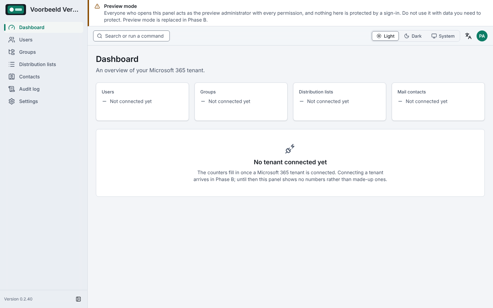
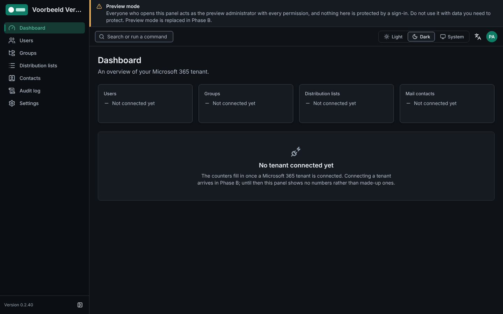
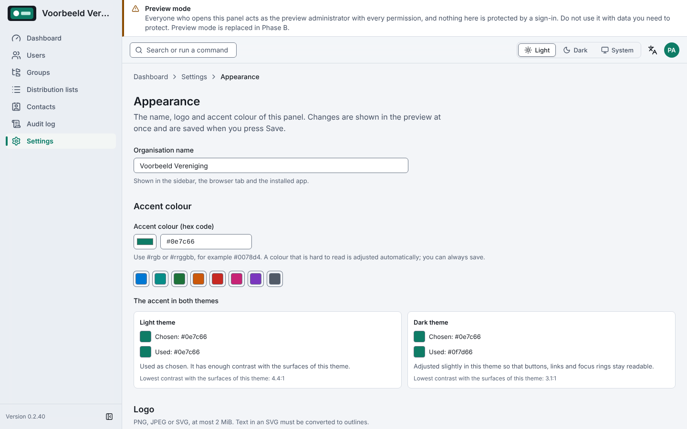
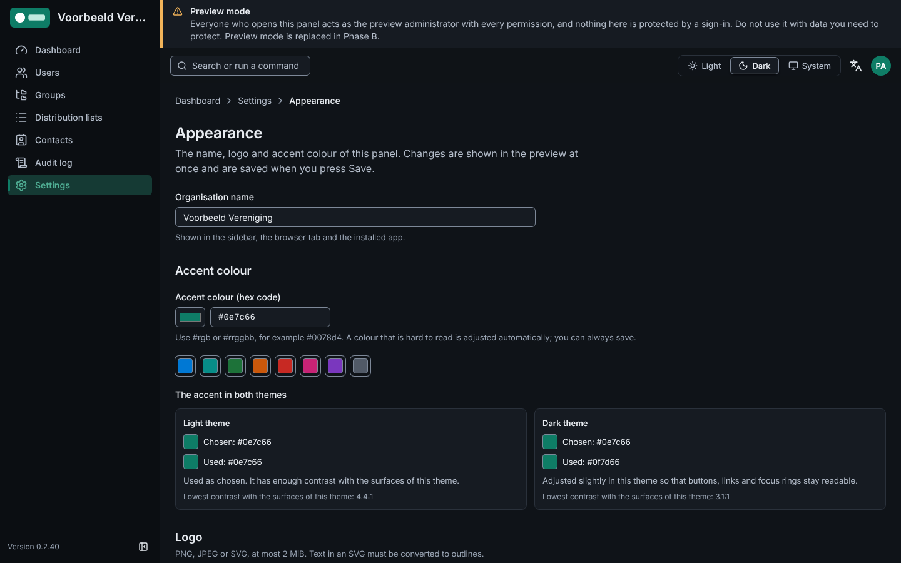
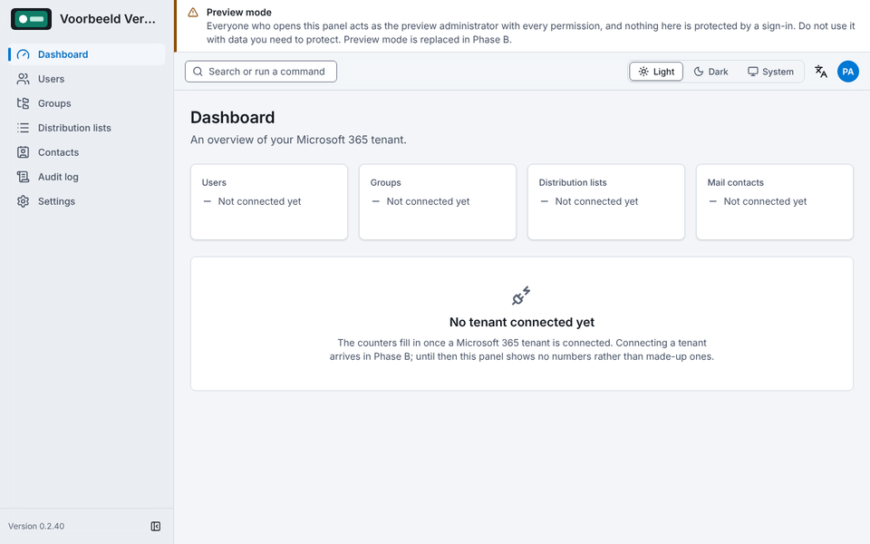

# M365Portal

> Nederlandse versie: zie [Nederlands](#nederlands). English first.

## English

M365Portal is a self-hosted web panel for administering a Microsoft 365 tenant (users, groups,
distribution lists, contacts) from one place. It runs as one container with one volume.

### Status, honestly

This is **Phase D step D1, distribution lists, contacts and group members**, on top of Phase C (users and groups, read only), Phase B (the connection and the sign-in) and the Phase A foundation. Phase D is delivered in three steps; D1 is built and waits for your test against a Microsoft 365 test tenant. What exists and works:

- the application shell (sidebar, header, command palette `Ctrl+K`, light and dark theme, Dutch and English),
- organisation branding (name, logo upload, accent colour with a contrast guarantee, export and import),
- a **setup wizard** that connects the panel to your Microsoft 365 tenant (it creates the application, its
  certificate and its permissions for you; you sign in once with a device code) or, when your tenant blocks the
  device code flow, a **manual mode** with a checklist,
- **sign-in with Microsoft Entra** (authorization code flow with PKCE, a certificate instead of a client secret,
  multi-factor required by default) and server-side sessions with timeouts and a step-up for sensitive actions,
- **roles on the server**: five built-in roles (Eigenaar, Beheerder, Operator, Helpdesk, Lezer) and the Bestuur
  template, bound to users or Entra groups, with scopes, enforced on every route and audited,
- a **break-glass** account (optional) that can only restore an Owner, and the command-line tools for the key,
  the setup token and the audit chain,
- **Users and Groups, read only** (Phase C): a paged list with prefix search and filters (users: enabled or
  disabled, member or guest; groups: Microsoft 365, security, mail-enabled security, distribution) and a
  detail page with the manager and group memberships of a user, and the owners and members of a group. The
  server shows each actor only what their role and scope allow; objects outside it appear as "restricted"
  without a name. Nothing is created, changed or deleted, there is no licence column, and the panel asks
  Microsoft for no new permission ([docs/api.md](docs/api.md), [docs/permissions.md](docs/permissions.md)),
- **Distribution lists, mail contacts and group members** (Phase D step D1, the first features that write): the
  Distribution lists page (search, filter on standard, dynamic and synchronised lists, members, **add and remove
  members** with a result per member), the Contacts page (**create, edit, delete** a mail contact, with validation, a
  typed confirmation and the lists it is removed from), and **add and remove members of Microsoft 365 and
  security groups** on the Groups page. Exchange is called over REST (`InvokeCommand`, on the same application token
  as Graph), so **no PowerShell and no Ubuntu image are needed** and the image is distroless (see
  [docs/operations.md](docs/operations.md#exchange-over-invokecommand-phase-d-adr-0182), ADR-0182). The panel asks
  Microsoft for no new permission; `GroupMember.ReadWrite.All` is now used ([docs/permissions.md](docs/permissions.md), Part 5),
- a hardened server and container image (strict security headers, rate limits, read-only root file system, audit log with a hash chain).

What does **not** exist yet:

- **The Exchange features are not proven against a real tenant.** They use the `InvokeCommand` endpoint, which
  Microsoft does not document (a recorded exception, ADR-0182); it has not been run against a real tenant (U101,
  OV-D1). If Exchange cannot be reached, every Exchange page answers "Exchange is unavailable" while the rest of the panel,
  group member editing included, works ([docs/open-points.md](docs/open-points.md), FD-01).
- **The image size ceiling is still 600 MB.** It was set for the Ubuntu image of step D1 (538.2 MB); ADR-0182 returned
  to the distroless image, which is far smaller, so the owner may lower it again
  ([docs/operations.md](docs/operations.md#exchange-over-invokecommand-phase-d-adr-0182)).
- Users and groups themselves are not created, changed or deleted, there is no password reset and no licence
  (U17, U48 deferred). Dynamic distribution lists are shown but their members are not listed and cannot be changed.
- No Phase D feature has run against a real Microsoft 365 tenant yet; the claims U75 to U100 are closed by the
  owner test in [docs/owner-test-phase-d1.md](docs/owner-test-phase-d1.md).
- Some Microsoft behaviour could only be read, not tried (for example the manager of a user for an
  application, and groups with hidden membership); the open claims U66 to U74 are closed by a test against a
  real tenant, step by step in [docs/owner-test-phase-c.md](docs/owner-test-phase-c.md).
- There is no screen for the audit log, no CSV export and no role administration yet (Phase D steps D2 and D3); the CLI and the API cover the audit chain.
- **Preview mode is gone.** Without a configured tenant the panel answers only the setup gate; nobody acts as
  administrator without signing in.

The licence is **not decided yet** (open decision OD-01 in [docs/open-points.md](docs/open-points.md)); until it
is, no licence is granted.

### Install in 5 minutes

You need Docker. The published image `ghcr.io/flux76hq/m365portal` exists only after the first run of the
publish workflow on GitHub, which has not happened yet. Until then build it yourself; the result is the same:

```sh
docker build --build-arg VERSION="$(cat VERSION)" -t m365portal:local .
```

Behind a proxy that inspects TLS, add the proxy certificate as a BuildKit secret (it never enters an image
layer): `--secret id=extra_ca,src=/path/to/ca-bundle.crt`. Where Docker has no bridge network, add
`--network host`. Without `--build-arg VERSION` the image says version `unknown` on purpose.

Running it needs a sealing key first: see [First run](#first-run) below. For the published image replace
`m365portal:local` by `ghcr.io/flux76hq/m365portal`.

With Docker Compose:

```sh
cp .env.example .env      # optional; every default applies without it
mkdir -p secrets && docker run --rm -i m365portal:local dist/cli.js generate-app-key > secrets/app_key
docker compose up -d
```

The Compose file mounts `secrets/app_key` as a Docker secret (see First run). It pulls the published image; before the first publish run, build as above and set
`image: m365portal:local` in `docker-compose.yml`. With host networking (`docker run --network host`) `PORT` is
the host port.

**Ports.** `PORT` is the port inside the container (1024 to 65535, default 9300). `HOST_PORT` exists in Compose only
and is the port the browser uses (default 9300). Every write is compared with `PUBLIC_BASE_URL`, so it **must equal
the address in the browser's address bar** (without path). Change the host port with Compose by `HOST_PORT=9090` in
`.env` (`PUBLIC_BASE_URL` follows); with `docker run` by `-p 9090:9300 -e PUBLIC_BASE_URL=http://localhost:9090`.
A mismatch shows as `403 origin_not_allowed`, and the message names the variable.

### First run

The first start has five steps. You need a computer that can reach `https://login.microsoftonline.com`,
`https://graph.microsoft.com` and `https://outlook.office365.com`, a browser, and a Microsoft 365 account with
the rights listed in step 4.

1. **Create the sealing key.** It seals the private key of the application's certificate in the database. The
   command `generate-app-key` prints a new key; keep it in a file that is not in git and **back it up
   separately from the data volume** (whoever holds the key and the volume holds the certificate).
   With Compose the key is the Docker secret `secrets/app_key`:

   ```sh
   mkdir -p secrets && docker run --rm -i m365portal:local dist/cli.js generate-app-key > secrets/app_key
   ```

2. **Start the panel.** With Compose: `docker compose up -d`. Without Compose pass the key as `APP_KEY` (the
   value is visible to `docker inspect`; prefer a key file or a platform secret in production):

   ```sh
   docker run -d --name m365portal -p 127.0.0.1:9300:9300 -v m365:/data \
     -e APP_KEY="$(cat secrets/app_key)" m365portal:local
   ```

   `PUBLIC_BASE_URL` must equal the address in your browser: `http://localhost:9300` works for a trial on your
   own computer (change the published port with `HOST_PORT`, and `PUBLIC_BASE_URL` follows); anywhere else use
   an `https://` address behind a reverse proxy (see [docs/operations.md](docs/operations.md)).

3. **Print the setup token.** An unconfigured panel is protected by a one-time token that is never logged.
   The command `setup-token` prints it:

   ```sh
   docker exec m365portal /nodejs/bin/node dist/cli.js setup-token
   ```

   With Compose the container is called `m365portal-m365portal-1` (check with `docker ps`). Set `SETUP_TOKEN`
   yourself if you prefer a fixed value, and remove it after the first installation.

4. **Open `/setup`**, for example <http://localhost:9300/setup>, and enter the token. The wizard checks the
   environment and then asks you to sign in with a device code. The account must be a **Global Administrator**,
   or hold **Privileged Role Administrator** plus **Application Administrator** (or **Cloud Application
   Administrator**). Leave "Consent on behalf of your organization" **off** (consent for yourself only). The
   wizard creates the application, uploads a self-signed certificate, grants the four application permissions
   and the Exchange role, and verifies the connection. If your tenant blocks the device code flow, choose manual
   mode.

5. **Sign in as the first Owner.** Pick the Entra group (or user) that administers the panel, finish the wizard
   and sign in with Microsoft. The wizard locks (`/setup` answers 404) at the first successful sign-in of the
   designated Owner. If you lock yourself out, see "Break-glass" and `setup-reopen` in
   [docs/operations.md](docs/operations.md).

### Configuration

| Variable | Default | Meaning |
|---|---|---|
| `HOST_PORT` | `9300` | Compose only: the port published on the Docker host |
| `PORT` | `9300` | The port the process listens on inside the container (1024 to 65535) |
| `HOST` | `0.0.0.0` | Bind address inside the container |
| `DATA_DIR` | `/data` | Database and files; must match the volume |
| `PUBLIC_BASE_URL` | `http://localhost:<port>` | The origin the browser uses; every write is compared with it |
| `TRUST_PROXY` | `none` | Proxies to trust for the client address; keep `none` without a reverse proxy |
| `SHOWCASE` | `false` | Serves the `/design` component showcase |
| `LOG_LEVEL` | `info` | `trace` to `fatal`, or `silent` |
| `HSTS_MAX_AGE` | `31536000` | Seconds for `Strict-Transport-Security` (https only) |
| `HSTS_INCLUDE_SUBDOMAINS` | `false` | Adds `includeSubDomains` |
| `HSTS_PRELOAD` | `false` | Adds `preload`; needs the setting above and a max-age of one year or more |
| `APP_KEY` / `APP_KEY_FILE` | unset | The sealing key (exactly one of the two; Compose uses the file `/run/secrets/app_key`) |
| `APP_KEY_PREVIOUS` / `APP_KEY_PREVIOUS_FILE` | unset | The old key, only while `rotate-app-key` runs |
| `SETUP_TOKEN` | unset | Optional fixed setup token; unset: the token file `/data/setup-token` |
| `BOOTSTRAP_CLIENT_ID` | Microsoft's public client | The client of the wizard's device-code sign-in |
| `SETUP_PROPAGATION_TIMEOUT_SECONDS` | `900` | How long the wizard waits for a role to take effect |
| `SESSION_IDLE_TIMEOUT_MINUTES` | `30` | Idle timeout of a session |
| `SESSION_ABSOLUTE_TIMEOUT_HOURS` | `8` | Absolute lifetime of a session |
| `GROUP_CACHE_TTL_SECONDS` | `300` | How long a group membership is cached |
| `AUTH_REQUIRE_MFA` | `true` | Require a multi-factor sign-in from Entra |
| `AUTH_MFA_AMR_VALUES` | `mfa,multipleauthn` | The `amr` values that count as multi-factor |
| `BREAK_GLASS_USERNAME` / `BREAK_GLASS_PASSWORD_HASH` | unset | Optional emergency account that can only restore an Owner (both or neither) |

The full table with all rules is in [docs/operations.md](docs/operations.md#environment-variables). An invalid
value stops the start and names the variable.

### What it looks like

| Light | Dark |
|---|---|
|  |  |
|  |  |



The images are generated with `pnpm media` from the real application, with a made-up
organisation and logo. They show the version number of the build they were made with and go stale at the next
version bump.

### What to check after the start

1. `http://localhost:9300/healthz` answers 200 with the version (the process lives).
2. `http://localhost:9300/readyz` answers 200 (the data directory is writable, the database is open). A 503
   names the failing check.
3. `docker ps` shows `healthy` after about half a minute.
4. `http://localhost:9300/` shows the setup gate on a new installation, and the sign-in page once the wizard is done.
5. Stop and start the container: the configuration is still there (it lives in the volume) and `/setup` answers 404.

```sh
curl -s http://127.0.0.1:9300/healthz
curl -s http://127.0.0.1:9300/readyz
```

What was run, and where: see [the gate note of the documentation](specs/001-m365portal/gate-notes/G8.md).

### Limits as numbers

Whatever sits in front of the panel (reverse proxy, firewall) must allow requests of **at least 9,437,184 bytes**:
that is the largest request, the branding import. All other limits (image size, rate limits, timeouts, quota,
retention) are listed as numbers in [docs/operations.md](docs/operations.md#limits-outside-the-repository) and are defined once in `packages/shared`.

### Security

The container runs unprivileged (uid 65532), with a read-only root file system and all capabilities dropped. The image
is distroless (no shell, no curl); the Exchange client may call ten fixed cmdlets and nothing else, and uses the
same certificate-based application token as Graph, so no key leaves the secrets module. The panel sets a session cookie (`HttpOnly`, `SameSite=Strict`, `__Host-` over https) and sends a strict Content-Security-Policy with Trusted Types. Its secrets are sealed with the key you created in the first run. Uploaded
images are re-encoded; SVG is sanitised and rasterised. Read [docs/security.md](docs/security.md) before putting
it anywhere but your own computer. Report vulnerabilities privately to the owner of the repository, not in a public issue.

### Documentation

- [docs/operations.md](docs/operations.md): setup, ports, environment, backup, update, health, limits
- [docs/architecture.md](docs/architecture.md): components, request pipeline, performance architecture, dependencies, accessibility
- [docs/security.md](docs/security.md): threat model, STRIDE tables, attack review, controls, SVG allowlist
- [docs/permissions.md](docs/permissions.md): the permission catalogue, the role matrix and the Microsoft Graph and Exchange permissions
- [docs/api.md](docs/api.md): the users and groups routes of Phase C and the distribution list, contact and group member routes of Phase D step D1 (queries, paging, answers, errors)
- [docs/owner-test-phase-c.md](docs/owner-test-phase-c.md): the step list to try Phase C against a Microsoft 365 test tenant
- [docs/owner-test-phase-d1.md](docs/owner-test-phase-d1.md): the step list to try Phase D step D1 against a Microsoft 365 test tenant; [docs/phase-reports/phase-D1.md](docs/phase-reports/phase-D1.md): the report of step D1
- [docs/open-points.md](docs/open-points.md): open decisions, unverified claims, assumptions and risks
- [docs/adr/](docs/adr/): architecture decision records (ADR-0001 onwards)
- [deploy/README.md](deploy/README.md): short deployment notes; [specs/001-m365portal](specs/001-m365portal), [specs/002-phase-b](specs/002-phase-b) and [specs/003-phase-c](specs/003-phase-c) and [specs/004-phase-d](specs/004-phase-d): the specifications of Phases A to D

### Contributing

Read [AGENTS.md](AGENTS.md) first: versioning, hooks and CI controls, secret hygiene, the documentation
contract and the pull request workflow. `pnpm docs:check` checks the documentation.

## Nederlands

M365Portal is een zelf te hosten webpaneel om een Microsoft 365-tenant (gebruikers, groepen, distributielijsten,
contacten) vanaf één plek te beheren. Het draait als één container met één volume.

### Status, eerlijk

Dit is **Fase D stap D1, distributielijsten, contacten en groepsleden**, bovenop Fase C (gebruikers en groepen, alleen lezen), Fase B (de verbinding en de aanmelding) en het fundament van Fase A. Fase D komt in drie stappen; D1 is gebouwd en wacht op jouw test tegen een Microsoft 365-testtenant. Wat er is en werkt:

- de applicatieschil (zijbalk, kopbalk, opdrachtenpalet `Ctrl+K`, licht en donker thema, Nederlands en Engels),
- organisatiebranding (naam, logo uploaden, accentkleur met contrastgarantie, export en import),
- een **installatiewizard** die het paneel met uw Microsoft 365-tenant verbindt (hij maakt de applicatie, het
  certificaat en de rechten voor u aan; u meldt zich één keer aan met een apparaatcode) of, als uw tenant de
  apparaatcodestroom blokkeert, een **handmatige modus** met een controlelijst,
- **aanmelden met Microsoft Entra** (autorisatiecodestroom met PKCE, een certificaat in plaats van een
  clientgeheim, standaard meervoudige verificatie) en sessies op de server met time-outs en een extra
  verificatie voor gevoelige handelingen,
- **rollen op de server**: vijf vaste rollen (Eigenaar, Beheerder, Operator, Helpdesk, Lezer) en het sjabloon
  Bestuur, gekoppeld aan gebruikers of Entra-groepen, met scopes, op elke route afgedwongen en gecontroleerd,
- een optioneel **break-glass**-account dat alleen een Eigenaar kan herstellen, en opdrachtregelhulpmiddelen voor
  de sleutel, het setup-token en de auditketen,
- **Gebruikers en Groepen, alleen lezen** (Fase C): een lijst met paginering, zoeken op het begin van een naam
  en filters (gebruikers: ingeschakeld of uitgeschakeld, lid of gast; groepen: Microsoft 365, beveiliging,
  e-mailbeveiliging, distributie) en een detailpagina met de manager en groepslidmaatschappen van een
  gebruiker, en de eigenaren en leden van een groep. De server toont elke aanvrager alleen wat rol en scope
  toestaan; objecten daarbuiten staan er als "beperkt" zonder naam. Er wordt niets aangemaakt, gewijzigd of
  verwijderd, er is geen licentiekolom en het paneel vraagt Microsoft om geen nieuw recht
  ([docs/api.md](docs/api.md), [docs/permissions.md](docs/permissions.md)),
- **Distributielijsten, mailcontacten en groepsleden** (Fase D stap D1, de eerste functies die schrijven): de pagina
  Distributielijsten (zoeken, filter op standaard, dynamische en gesynchroniseerde lijsten, leden, **leden toevoegen
  en verwijderen** met een resultaat per lid), de pagina Contacten (een mailcontact **aanmaken, bewerken,
  verwijderen**, met validatie, een getypte bevestiging en de lijsten waaruit het wordt gehaald) en **leden van
  Microsoft 365- en beveiligingsgroepen toevoegen en verwijderen** op de pagina Groepen. Exchange wordt
  via REST aangeroepen (`InvokeCommand`, met hetzelfde applicatietoken als Graph), dus **PowerShell en een
  Ubuntu-image zijn niet nodig** en de image is distroless (zie
  [docs/operations.md](docs/operations.md#exchange-via-invokecommand-fase-d-adr-0182), ADR-0182). Het paneel vraagt Microsoft om geen nieuw
  recht; `GroupMember.ReadWrite.All` wordt nu gebruikt ([docs/permissions.md](docs/permissions.md), Deel 5),
- een geharde server en containerimage (strikte beveiligingskoppen, aanvraaglimieten, alleen-lezen rootbestandssysteem, auditlog met hashketen).

Wat er **nog niet** is:

- **De Exchange-functies zijn niet bewezen tegen een echte tenant.** Ze gebruiken het endpoint `InvokeCommand`, dat
  Microsoft niet documenteert (een vastgelegde uitzondering, ADR-0182); het is niet gedraaid tegen een echte tenant
  (U101, OV-D1). Is Exchange niet te bereiken, dan antwoordt elke Exchange-pagina "Exchange is niet beschikbaar" terwijl de
  rest van het paneel, groepsledenbeheer inbegrepen, werkt ([docs/open-points.md](docs/open-points.md), FD-01).
- **Het plafond voor de grootte van de image is nog 600 MB.** Het is gezet voor de Ubuntu-image van stap D1 (538,2 MB);
  ADR-0182 ging terug naar de veel kleinere distroless-image, dus de eigenaar kan het weer verlagen
  ([docs/operations.md](docs/operations.md#exchange-via-invokecommand-fase-d-adr-0182)).
- Gebruikers en groepen zelf worden niet aangemaakt, gewijzigd of verwijderd, er is geen wachtwoordreset en geen
  licentie (U17, U48 uitgesteld). Dynamische distributielijsten worden getoond maar hun leden niet en ze zijn niet
  te wijzigen.
- Geen enkele functie van Fase D is al tegen een echte Microsoft 365-tenant gedraaid; de claims U75 tot en met U100
  sluit de eigenaarstest in [docs/owner-test-phase-d1.md](docs/owner-test-phase-d1.md).
- Sommig Microsoft-gedrag kon alleen worden gelezen, niet geprobeerd (bijvoorbeeld de manager van een
  gebruiker voor een applicatie en groepen met verborgen lidmaatschap); de open claims U66 tot en met U74
  sluit een test tegen een echte tenant, stap voor stap in [docs/owner-test-phase-c.md](docs/owner-test-phase-c.md).
- Er is nog geen scherm voor het auditlog, geen CSV-export en geen rollenbeheer (Fase D, stappen D2 en D3); de opdrachtregel dekt de auditketen.
- **De previewmodus is verwijderd.** Zonder ingestelde tenant antwoordt het paneel alleen met de installatiepoort;
  niemand treedt als beheerder op zonder aan te melden.

De licentie is **nog niet besloten** (open beslissing OD-01 in [docs/open-points.md](docs/open-points.md)); zolang
dat zo is, wordt er geen licentie verleend.

### Installeren in 5 minuten

Je hebt Docker nodig. De gepubliceerde image `ghcr.io/flux76hq/m365portal` bestaat pas na de eerste run van de
publish-workflow op GitHub, en die is nog niet geweest. Bouw hem tot die tijd zelf; het resultaat is hetzelfde:

```sh
docker build --build-arg VERSION="$(cat VERSION)" -t m365portal:local .
```

Achter een proxy die TLS inspecteert voeg je het proxycertificaat toe als BuildKit-secret (het komt nooit in een
imagelaag): `--secret id=extra_ca,src=/pad/naar/ca-bundle.crt`. Waar Docker geen bridge-netwerk heeft, voeg je
`--network host` toe. Zonder `--build-arg VERSION` meldt de image bewust versie `unknown`.

Voor het draaien is eerst een versleutelsleutel nodig: zie [Eerste start](#eerste-start) hieronder. Voor de
gepubliceerde image vervang je `m365portal:local` door `ghcr.io/flux76hq/m365portal`.

Met Docker Compose:

```sh
cp .env.example .env      # optioneel; zonder dit gelden alle standaardwaarden
mkdir -p secrets && docker run --rm -i m365portal:local dist/cli.js generate-app-key > secrets/app_key
docker compose up -d
```

Het Compose-bestand koppelt `secrets/app_key` als Docker-secret (zie Eerste start). Het haalt de gepubliceerde image op; bouw vóór de eerste publish-run zoals hierboven en zet
`image: m365portal:local` in `docker-compose.yml`. Met hostnetwerk (`docker run --network host`) is `PORT` de
hostpoort.

**Poorten.** `PORT` is de poort in de container (1024 tot 65535, standaard 9300). `HOST_PORT` bestaat alleen in
Compose en is de poort die de browser gebruikt (standaard 9300). Elke schrijfactie wordt vergeleken met
`PUBLIC_BASE_URL`, dus die **moet gelijk zijn aan het adres in de adresbalk** (zonder pad). Wijzig de hostpoort met
Compose via `HOST_PORT=9090` in `.env` (`PUBLIC_BASE_URL` volgt); met `docker run` via
`-p 9090:9300 -e PUBLIC_BASE_URL=http://localhost:9090`. Een verschil geeft `403 origin_not_allowed`, met de naam van
de variabele in de melding.

### Eerste start

De eerste start heeft vijf stappen. U hebt een computer nodig die `https://login.microsoftonline.com`,
`https://graph.microsoft.com` en `https://outlook.office365.com` kan bereiken, een browser en een Microsoft
365-account met de rechten uit stap 4.

1. **Maak de versleutelsleutel.** Hij versleutelt de privésleutel van het certificaat van de applicatie in de
   database. De opdracht `generate-app-key` drukt een nieuwe sleutel af; bewaar hem in een bestand dat niet in git
   staat en **maak een back-up los van het datavolume** (wie de sleutel en het volume heeft, heeft het
   certificaat). Met Compose is de sleutel het Docker-secret `secrets/app_key`:

   ```sh
   mkdir -p secrets && docker run --rm -i m365portal:local dist/cli.js generate-app-key > secrets/app_key
   ```

2. **Start het paneel.** Met Compose: `docker compose up -d`. Zonder Compose geef je de sleutel mee als `APP_KEY`
   (de waarde is zichtbaar voor `docker inspect`; gebruik in productie liever een sleutelbestand of een
   platformgeheim):

   ```sh
   docker run -d --name m365portal -p 127.0.0.1:9300:9300 -v m365:/data \
     -e APP_KEY="$(cat secrets/app_key)" m365portal:local
   ```

   `PUBLIC_BASE_URL` moet gelijk zijn aan het adres in uw browser: `http://localhost:9300` werkt voor een proef op
   uw eigen computer (de gepubliceerde poort wijzigt u met `HOST_PORT`, `PUBLIC_BASE_URL` volgt); gebruik
   overal elders een `https://`-adres achter een reverse proxy (zie [docs/operations.md](docs/operations.md)).

3. **Druk het setup-token af.** Een niet-ingesteld paneel wordt beschermd door een eenmalig token dat nooit in
   een log komt. De opdracht `setup-token` drukt het af:

   ```sh
   docker exec m365portal /nodejs/bin/node dist/cli.js setup-token
   ```

   Met Compose heet de container `m365portal-m365portal-1` (controleer met `docker ps`). Stel `SETUP_TOKEN` zelf
   in als u een vaste waarde wilt, en verwijder hem na de eerste installatie.

4. **Open `/setup`**, bijvoorbeeld <http://localhost:9300/setup>, en voer het token in. De wizard controleert de
   omgeving en vraagt u daarna aan te melden met een apparaatcode. Het account van de beheerder moet **Global Administrator** zijn,
   of **Privileged Role Administrator** hebben plus **Application Administrator** (of **Cloud Application
   Administrator**). Laat "Consent on behalf of your organization" (toestemming namens uw organisatie) **uit**: u
   geeft alleen voor uzelf toestemming. De wizard maakt de applicatie, uploadt een zelfondertekend certificaat, geeft
   de vier applicatierechten en de Exchange-rol, en controleert de verbinding. Blokkeert uw tenant de
   apparaatcodestroom, kies dan de handmatige modus.

5. **Meld aan als eerste Eigenaar.** Kies de Entra-groep (of gebruiker) die het paneel beheert, rond de wizard af en
   meld aan met Microsoft. De wizard sluit (`/setup` antwoordt 404) bij de eerste geslaagde aanmelding van de
   aangewezen Eigenaar. Sluit u zichzelf buiten, zie dan "Break-glass" en `setup-reopen` in
   [docs/operations.md](docs/operations.md).

### Configuratie

De tabel in het Engelse deel geeft alle variabelen met hun standaardwaarde (`HOST_PORT`, `PORT`, `HOST`, `DATA_DIR`,
`PUBLIC_BASE_URL`, `TRUST_PROXY`, `SHOWCASE`, `LOG_LEVEL`, `HSTS_MAX_AGE`, `HSTS_INCLUDE_SUBDOMAINS`,
`HSTS_PRELOAD`, `APP_KEY`, `APP_KEY_FILE`, `APP_KEY_PREVIOUS`, `SETUP_TOKEN`, `BOOTSTRAP_CLIENT_ID`, de sessie-, groeps-,
MFA- en break-glass-variabelen; de volledige tabel met alle regels staat in
[docs/operations.md](docs/operations.md#environment-variables). Een ongeldige waarde stopt de start en noemt de
variabele.

### Hoe het eruitziet


De afbeeldingen worden met `pnpm media` gemaakt van de echte applicatie, met een verzonnen
organisatie en logo. Ze tonen het versienummer van de build waarmee ze zijn gemaakt en lopen achter na de volgende
versieverhoging.

### Wat je na de start controleert

1. `http://localhost:9300/healthz` geeft 200 met de versie (het proces leeft).
2. `http://localhost:9300/readyz` geeft 200 (de datamap is schrijfbaar, de database is open). Bij 503 staat de
   falende controle in het antwoord.
3. `docker ps` toont na ongeveer een halve minuut `healthy`.
4. `http://localhost:9300/` toont op een nieuwe installatie de installatiepoort en na de wizard de aanmeldpagina.
5. Stop en start de container: de configuratie is er nog (die staat in het volume) en `/setup` antwoordt 404.

Wat er is uitgevoerd en waar: zie [de gate-notitie van de documentatie](specs/001-m365portal/gate-notes/G8.md).

### Grenzen als getallen

Alles wat voor het paneel staat (reverse proxy, firewall) moet verzoeken van **minstens 9.437.184 bytes** toestaan:
dat is het grootste verzoek, de brandingimport. Alle andere grenzen (afbeeldingsgrootte, aanvraaglimieten, time-outs,
quotum, bewaartermijn) staan als getallen in [docs/operations.md](docs/operations.md#limits-outside-the-repository) en
zijn eenmalig vastgelegd in `packages/shared`.

### Beveiliging

De container draait zonder rechten (uid 65532), met alleen-lezen rootbestandssysteem, alle capabilities weggehaald
en alle capabilities weggehaald. De image is distroless (geen shell, geen curl); de Exchange-client mag tien vaste cmdlets aanroepen en niets anders, en gebruikt hetzelfde certificaatgebonden applicatietoken als Graph, zodat er geen sleutel de geheimenmodule verlaat. Het paneel zet een sessiecookie (`HttpOnly`, `SameSite=Strict`, `__Host-` via https) en stuurt een strikte
Content-Security-Policy met Trusted Types. De geheimen zijn versleuteld met de sleutel uit de eerste start. Geüploade afbeeldingen worden opnieuw gecodeerd; SVG wordt gezuiverd en gerasterd. Lees
[docs/security.md](docs/security.md) voordat je het ergens anders dan op je eigen computer neerzet. Meld kwetsbaarheden
privé bij de eigenaar van de repository, niet in een openbaar issue.

### Documentatie

- [docs/operations.md](docs/operations.md): installatie, poorten, omgeving, back-up, bijwerken, gezondheid, grenzen
- [docs/architecture.md](docs/architecture.md): onderdelen, verzoekpijplijn, prestatie-architectuur, afhankelijkheden, toegankelijkheid
- [docs/security.md](docs/security.md): dreigingsmodel, STRIDE-tabellen, aanvalsbeoordeling, maatregelen, SVG-toegestane lijst
- [docs/permissions.md](docs/permissions.md): de rechtencatalogus, de rollenmatrix en de Microsoft Graph- en Exchange-rechten
- [docs/api.md](docs/api.md): de routes voor gebruikers en groepen van Fase C en voor distributielijsten, contacten en groepsleden van Fase D stap D1 (queries, paginering, antwoorden, fouten)
- [docs/owner-test-phase-c.md](docs/owner-test-phase-c.md): de stappenlijst om Fase C tegen een Microsoft 365-testtenant te proberen
- [docs/owner-test-phase-d1.md](docs/owner-test-phase-d1.md): de stappenlijst om Fase D stap D1 tegen een Microsoft 365-testtenant te proberen; [docs/phase-reports/phase-D1.md](docs/phase-reports/phase-D1.md): het rapport van stap D1
- [docs/open-points.md](docs/open-points.md): open beslissingen, onbevestigde claims, aannames en risico's
- [docs/adr/](docs/adr/): architectuurbeslissingen (ADR-0001 en verder)
- [deploy/README.md](deploy/README.md): korte uitrolnotities; [specs/001-m365portal](specs/001-m365portal), [specs/002-phase-b](specs/002-phase-b) en [specs/003-phase-c](specs/003-phase-c) en [specs/004-phase-d](specs/004-phase-d): de specificaties van Fase A tot en met D

### Bijdragen

Lees eerst [AGENTS.md](AGENTS.md): versiebeheer, hooks en CI-controles, omgang met geheimen, het
documentatiecontract en de pull-requestwerkwijze. `pnpm docs:check` controleert de documentatie.
